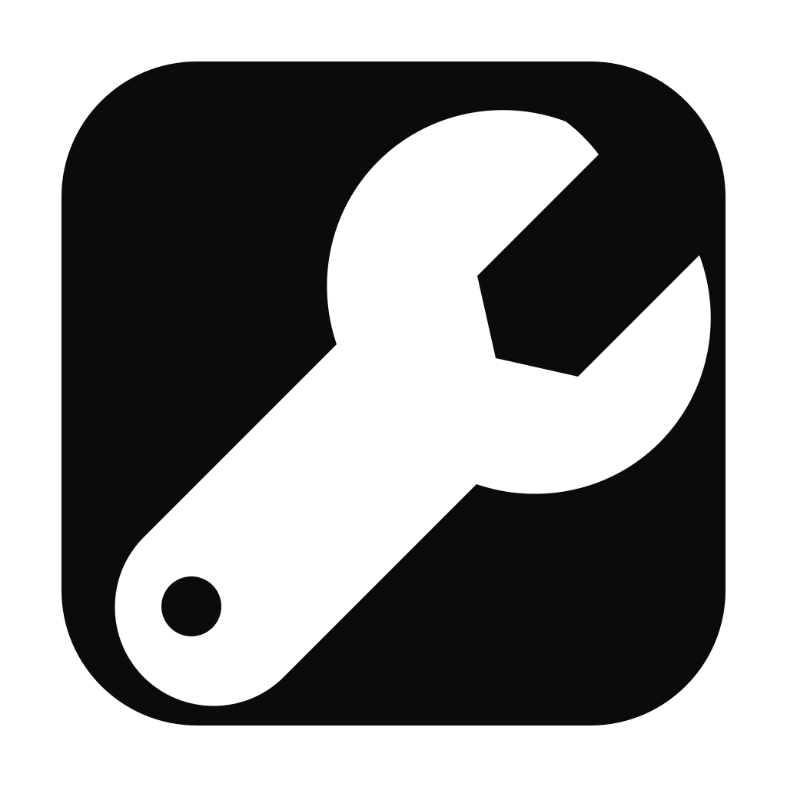

<p align="center">
  
</p>

<h1 align="center">KOS Toolbox &amp; KOS Governor</h1>

<p align="center">
  Two native Windows tools for tuning and maintaining a gaming PC, built for <b>KOS</b> (a customized Windows 11 setup).<br />
  WPF · .NET 8 · x64 · no telemetry · everything reads the real system state before and after a change.
</p>

---

## What's in this repository

| Folder | Program | In one sentence |
|---|---|---|
| [`toolbox/`](toolbox/README.md) | **KOS Toolbox** | An all-in-one control panel: Windows tweaks, startup, power plans, services, devices/IRQs, BIOS settings (AMI SCEWIN), NVIDIA GPU tuning and driver profiles, display EDID, cleanup, network, app installer and the KOS maintenance scripts. |
| [`toolbox/src/KosFirewall`](toolbox/README.md) | **KOS Firewall** | An allow-list firewall in the Windows Filtering Platform, with Windows Firewall's switch and a hosts file editor: an app of its own built on the toolbox's window and theme (opened from the toolbox's sidebar and KOS Engine's tray menu, always as administrator). |
| [`toolbox/src/KosEqualizer`](toolbox/README.md) | **KOS Equalizer** | A parametric or graphic equalizer for each playback device, as an audio effect of its own (`toolbox/apo`), with a profile per device for gamemode: an app of its own built on the toolbox's window and theme (opened from the toolbox's sidebar and KOS Engine's tray menu, always as administrator). |
| [`shell/`](toolbox/README.md) | **KOS Shell** | A transparent, blurred or acrylic taskbar with an optional tint, for the Windows 10 and the Windows 11 taskbar (on Windows 11 also its buttons, indicators and hidden icons flyout), and dark mode for the Registry Editor, the management consoles, classic Notepad, Control Panel applets, System Configuration, Color Management, ODBC Data Sources and Properties dialogs, and Character Map, System Information, Add Hardware, User Accounts and Disk Cleanup (with the system colors replaced in those five only), no blank view between folders in File Explorer and icons on its classic context menus (C++, built by `shell\build.cmd`). Switched on in the toolbox (Windows › Visuals) and kept by KOS Engine. For the Windows 11 taskbar its `KosShell.dll` is loaded into Explorer; for dark mode, only into those apps (into File Explorer at its first dialog, and only dialogs change there); for the folders, into File Explorer at its first folder window. |
| [`governor/`](governor/README.md) | **KOS Governor** | A Process Lasso–style rules engine that runs in the tray: CPU/I/O/memory priority, affinity, CPU sets, efficiency mode and thread rules per program, a CPU limiter, per-program power plan and screen mode, timer resolution, a gamemode hotkey, a network killswitch hotkey, GPU profiles for gamemode, per-game Windows settings, the GPU fan curve, mouse settings for gamemode and a tray icon per device battery. |

The two are separate programs on purpose. The toolbox is something you open, change things in and close. The governor has to keep running in the background to enforce rules, so it's a small tray engine with its own UI. They share code: `KosGovernor.Core` references `KosToolbox.Core` (for example, KOS Engine runs the GPU fan curve you configure in the toolbox).

Each folder has its own detailed README with every setting, file path and known limitation.

---

## KOS Toolbox

A single window with a sidebar of pages in groups (Overview, Tune, System, Software, Diagnose) that collapses to icons. A **KOS Apps** group before Settings has KOS Governor, KOS Firewall and KOS Equalizer as buttons with an open glyph: a click opens the app in front (or brings the running one forward) and the current page stays selected. The toolbox, KOS Firewall and KOS Equalizer are single-instance: a second start brings the first window forward. Every change shows the **real** current value read from Windows (registry, services, BCD, power plans, drivers), saves a backup before applying, and re-reads the system afterwards to confirm it actually took. Buttons apply right away, without "are you sure?" prompts; the result (and any risk, such as a reduced protection) appears in a notification.

### Pages

- **Home** – live dashboard like Task Manager: a list of the hardware (CPU, memory, GPU, disks, network adapters, each with a live graph) and of the system's state on the left, and the selected row's full details on the right (every core, caches, instructions, CPUID/microcode; each RAM module, plus SPD and current timings read through the KOS tools' CPU-Z; every GPU sensor), disks (usage, latency, SSD/HDD, partitions, and SMART/NVMe health), network adapters, the KOS post-setup warnings/errors with what each one means, pending changes, and a **System status** list: refresh rate per display, Resizable BAR and the GPU's PCIe link, BypassIO (DirectStorage) per drive, crashes in the last 30 days, Game Bar, fullscreen mode, HAGS, NVIDIA P-states/MSI, MPO, VBS, memory integrity, timer resolution, Spectre/Meltdown mitigations, Windows Update, UAC, firewall, power plan, and whether the BIOS or Windows controls the CPU frequency.
- **Install** – one-click installer for a fresh PC. 40 apps by category (browsers, Discord/Spotify, game launchers, tools including WebView2, .NET runtimes, AnyDesk, WARP, the PawnIO sensor driver and the CapFrameX and NVIDIA FrameView frame-time tools, peripheral software). Apps with a Chocolatey package install through it (Chocolatey itself is installed from its signed MSI the first time); the rest always come from the official source or the developer's GitHub release. Shows what is already installed, a **Downloads** tab with progress bars, checks the Authenticode signature before opening any installer, runs installers one at a time from `C:\ProgramData\TheKOS\Toolbox\Downloads` and deletes them after a confirmed install; portable apps (Logitech Onboard Memory Manager) stay in the user's Downloads folder and show *Open* once downloaded. Discord offers Stable/PTB/Canary/Development and Vesktop/Equibop/Legcord; Spotify offers the official client or SpotX (new or old UI). Optional `aria2c` for multi-connection downloads. An **Updates** tab lists the installed programs with a newer version (Chocolatey's own list, or the developer's newest GitHub/winget release) and updates the checked ones; a **Microsoft Store** tab installs free Store apps from their link without the Store app, an account or Windows Update (packages from the Store's own delivery service, checked against its SHA-256, only the frameworks the app needs).
- **Windows** – curated tweaks grouped into Performance, Gaming, Visuals, System, Peripherals, Security and Connectivity, each with its options, the KOS default and a restore button. Gaming splits Game Bar from the fullscreen mode and has the DirectX windowed/VRR/Auto HDR switches and the services FiveM servers check; System has Windows Update (including a pause until 2038), background apps, diagnostics and Windows Search; Security has VBS and memory integrity as separate switches (plus clearing a VBS UEFI lock; turning one off warns when Riot Vanguard or FACEIT is installed), Hyper-V and the PowerShell execution policy; Connectivity has Nagle, network throttling, the VPN services and Teredo with the IP Helper service. Performance has processor scheduling (Win32PrioritySeparation) and the dynamic tick and HPET boot switches; Visuals has visual effects, *End task* in the taskbar and a transparent taskbar (KOS Shell: KOS Engine applies it and keeps it, for the Windows 10 and the Windows 11 taskbar); Peripherals has mouse acceleration and a switch that stops devices from installing their maker's software by themselves. Security includes individual controls for system CFG, per-process mitigations, driver DMA remapping and firewall rules. An optional Utilman control enables or restores a SYSTEM command prompt on the sign-in screen; the interface warns about physical access. Restoring default firewall rules removes custom rules. General switches the Start menu between Windows and Open-Shell (through the KOS script, read back from the Start menu app's file and Open-Shell's autostart option), greys out Start menu search while Open-Shell is the Start menu, and can suspend or fully disable the CTF Loader (ctfmon.exe) through the input service settings.
- **Windows Update** – the updates Windows Update offers this PC, listed, installed one by one or hidden while Windows Update itself stays off: each operation lets it run (services on manual, blocking policies removed), then puts every value back and stops the services. Points to KOS state afterwards, since updates can put back what the KOS changed.
- **Startup** – Autoruns-style list of everything that starts with Windows (Run keys, startup folders, scheduled tasks, services, drivers; Winlogon and Active Setup read-only; in Advanced, every scheduled task and, read-only, the system hooks: AppInit DLLs, image hijacks, boot execute, LSA packages, print monitors, known DLLs, Winsock providers and WMI subscriptions) with enable/disable that keeps the entry so it can be restored. A Signer column (the file's signature or the Windows catalog that lists it) with *Hide Microsoft-signed*, and a delayed start for Run entries (30 s, 1 min or 2 min after sign-in, through a scheduled task of the account).
- **Power** – KOS power profiles, core parking, hibernation (powercfg plus the hibernate policies) and a full power-plan editor (every subgroup and setting, AC/DC, hidden settings).
- **Services** – an *Options* tab with the start type of services KOS leaves as a choice (Credential Manager, DRM media, device setup, laptop ACPI drivers), and snapshots: capture, compare and restore service startup types; export as `.reg`.
- **Devices** – PCI devices and interrupts: MSI mode, message limit, interrupt priority and affinity, what is really in effect, advice, a suggested interrupt layout applied in one click and MSI for every supported device; ghost (disconnected) device cleanup.
- **BIOS** (AMI Aptio, through AMI SCEWIN in the KOS `tools\SCEWIN` folder) – reads every BIOS setting into `nvram.txt` and lists them like SCEWIN GUI (options, Enabled/Disabled, numbers, BIOS defaults, search and filters). Apply reads the BIOS again, saves the settings in use as a backup, imports only the changed settings and reads again to confirm. A **Backups** tab compares any backup with the current settings and restores the checked ones, like the Services page. Changes take effect after a restart.
- **Firewall** – opens **KOS Firewall**, an app of its own (always as administrator; also in KOS Engine's tray menu): an allow-list built in the Windows Filtering Platform: everything not allowed is blocked, while loopback, DHCP, DNS, ICMPv6 and the KOS programs are always allowed, so no rule can cut the PC off its network. Its filters are persistent and boot-time: they hold from the moment Windows starts, with no KOS process running. Rules allow or block a program (by path), a service (by its service SID, services inside svchost too), a Store app (by package SID) or a custom match (program, direction, protocol, ports, remote addresses), with NTP, Windows Update and Network discovery presets. Turning it on turns the Windows Firewall profiles off and turning it off puts them back; *Turn Windows Firewall on* turns KOS Firewall off. KOS Engine asks Allow, Until restart or Block when a program without a rule is blocked. A **Log** tab lists the filter engine's recent drops by KOS Firewall, with Allow / Block per program, and a **Hosts** tab edits the hosts file, checked line by line, with a backup on every save. A switch in the window's header turns KOS Firewall on or off, and an option makes KOS Engine's killswitch cut the local network too. Windows Security reports the firewall as off while KOS Firewall is on (it isn't a registered firewall product), and the Windows page won't turn the Base Filtering Engine off under it.
- **GPU** (NVIDIA, through NVML/NVAPI) – live status, overclocking (power limit, core/memory offsets, V/F curve with the card's current point, voltage lock, thermal limit, thermal slowdown; the chosen profile is applied every time the toolbox opens), fan control and a fan curve (executed by the governor), NVIDIA tweaks (P-states, HDCP, MSI, telemetry, NVIDIA tasks, debloat, shader cache, Profile Inspector presets), an AMD Radeon section when there is an AMD card (driver tweaks Safe/Experimental, AMD Software extras, Radeon Software Slimmer), display color settings, a **DRS** tab that edits driver profiles like NVIDIA Profile Inspector (settings the installed driver doesn't accept are detected and marked; *Profile for a program* opens the profile that has a chosen `.exe` or creates one for it, and profiles you made can be deleted) and a **Driver** tab: the installed display driver (remove it, or install an extracted AMD/Intel driver from a folder), the NVIDIA driver list for the card (Game Ready or Studio) with download, a choice of the package's components (only the display driver and NVI2 are required), a silent clean install and MSI/HDCP/telemetry tweaks afterwards, the Windows Update driver switch, and an advanced uninstall through Display Driver Uninstaller (now, or in Safe Mode).
- **Latency** – like LatencyMon, through a kernel trace (ETW, administrator): the longest DPC and ISR of each driver and each processor, interrupt-to-thread latency and hard pagefaults per process, with a verdict naming the driver that ran for 1 ms or more. Only reads. A **Mouse** tab like MouseTester (report rate and steadiness from raw input, graphs, CPI, CSV), a **Timer** tab that times `Sleep(1)` and a **Frames** tab: a timed PresentMon capture of a game (average FPS, 1 % and 0.1 % lows, frame-time spikes, the present mode it really got and tearing, with a frame-time plot; administrator).
- **Stability** – blue screens with the bug check, unexpected restarts, display driver resets and WHEA hardware errors from the System log, the crash dumps, and KOS Governor's gamemode session reports.
- **Display** – monitors' EDID and timings, like CRU: edit and save EDID overrides; brightness, contrast, input and factory reset over DDC/CI.
- **Cleanup** – installed apps and Appx packages (removable for every user, system apps included), disk usage scanner and junk cleaner (also Windows logs, Delivery Optimization, the Installer patch cache and Windows.old), third-party driver store packages, ghost devices. After an uninstall, the toolbox finds the program's leftovers, like Revo, Geek and HiBit Uninstaller. It looks for folders and shortcuts, registry keys and values, services and scheduled tasks that point to the program or have its exact name, and lists them for review. Checked items are deleted permanently, with a `.reg` backup of the registry first. **Force removal** does the same for a program whose uninstaller is broken. **Uninstall checked** removes several programs one after another, silently when their uninstaller allows it (MSI, a registered quiet command, Inno Setup, NSIS), then lists the leftovers of all of them at once. The disk usage scanner can compress a folder (a game, for example) with Windows' own executable compression and reports the size on disk before and after.
- **Network** – adapter advanced properties, offloads and bindings, global TCP settings, and DNS per adapter (DHCP, Cloudflare, Google or Quad9, optionally encrypted with DNS over HTTPS).
- **Peripherals** – the HID mice, keyboards, headsets and controllers connected, over plain HID with no vendor software. Razer mice (DPI and stages, polling rate, sleep timer, low-battery threshold, brightness, lighting effect and color; a picture of the device with its light in the chosen color; a gamemode profile per device) and the Razer Mouse Dock's ring light, Logitech HID++ mice (DPI, report rate, host mode) and the Attack Shark R82HE magnetic keyboard (ROYUAN gen2: polling rate, onboard profile, lighting, switch travel for every key or the chosen ones on a drawn keyboard, key modes, remap and Fn layer, per-key colors, live key travel) and the DualShock 4's light bar on its cable (a color or off; its polling rate counted from its reports) are configured on the device itself, each write read back; batteries of Razer, Logitech, Glorious/Hitscan/G-Wolves, Pulsar/Redragon, SteelSeries, Corsair, HyperX, PlayStation controllers and Bluetooth devices; VIA keyboards identified. Unsupported devices show their HID collections and a *Copy device report*, and nothing is sent to them. KOS Governor shows the batteries in its tray, can set a mouse's DPI and polling rate for gamemode, and can color the Mouse Dock's ring by the mouse battery.
- **Audio** – playback and recording devices: make one the default (or the default for communications), volume and mute, the format (sample rate and bit depth), exclusive mode and its priority, and audio enhancements off; every change is read back from the device.
- **Equalizer** – opens **KOS Equalizer**, an app of its own (always as administrator; also in KOS Engine's tray menu): turn it on per playback device (it replaces Equalizer APO on that device, and turning it off puts Equalizer APO back), then profiles per device, edited live as a parametric equalizer (up to 64 filters: peak, shelves, pass, notch, band-pass) or a 10, 15 or 31-band graphic one, with a preamp, a suggested preamp against clipping and the response curve; a gamemode profile per device that KOS Engine switches to; a built-in *Footsteps (FPS)* preset each device can pick; Equalizer APO and AutoEQ text imported from a file or pasted, and exported. A switch in the window's header bypasses it: every device plays flat without unregistering the effect, and each returns to its profile when it's switched back on. The device's Windows audio settings (the Audio page's) are below.
- **Tools** – launches the programs in the KOS tools folder and runs the KOS maintenance actions/fixes (restart to UEFI, network reset, time sync repair). Tools KOS doesn't ship are a link away, in Setup › Tools.
- **Settings** – preferences, logs, data folder, restart as administrator, and a **change history** of catalog settings (before → after, whether the reread confirmed it) with *Undo* on the latest change of each setting, refused when something changed it since.

### How it works

- **Declarative catalog.** Each tweak declares the exact settings it touches and the value of each per option. The state you see is computed from those reads; nothing is guessed from a saved flag.
- **Least privilege.** The toolbox can run as a normal user. When something needs admin rights, it starts an elevated copy of itself with a validated request (the tweak id and option, never raw values or commands).
- **Scripts are pinned.** The only scripts it runs are the KOS scripts listed in the catalog, under `%ProgramData%\TheKOS`, checked by SHA-256 and by file owner when elevated.
- **Backups and logs.** Per-user data in `%LocalAppData%\KOS\Toolbox`, logs in `%ProgramData%\TheKOS\Logs\Toolbox` (30 days).

---

## KOS Governor

One `KosGovernor.exe` with two modes: opened normally it shows the UI; with `--engine` it's the tray engine that applies the rules. Closing the window doesn't stop the rules; *Exit* in the tray does.

### Features

- **Process list** – live list with icon, PID, CPU/I/O/memory priority, threads, boost, efficiency mode, affinity and CPU sets; svchost rows expand to the services they host. Selecting a process opens a details panel at the bottom: its live values, CPU/I/O/memory priority and processors applied with one click, and a switch that keeps them as a rule. Rules, Gamemode, CPU masks and Settings are in the sidebar; the profile and the gamemode switch are at the bottom of the sidebar.
- **Rules per program** – CPU priority, I/O priority, memory priority, priority boost, Efficiency Mode (EcoQoS), GPU scheduling priority, CPU affinity and CPU sets; or *Suspend*/*Terminate*. Every menu item has *Apply now* (once) or *Always* (saves a rule). Core presets come from the CPU topology (SMT off, P/E/LP E-cores, each CCD, the 3D V-Cache or frequency CCD, all but core 0). A rule can wait a delay after the program starts, can also cover the programs its program opens (a launcher's game), and *Add From Open Programs* sets cores for several open programs at once (CPU sets for games, affinity for the rest).
- **Service and thread rules** – `+S` rules target the process hosting a service; `+T` rules match threads by description or start module (wildcards), with ideal processor and per-thread CPU sets.
- **CPU masks** – named processor groups (P-cores, E-cores, SMT off…) reused by every rule.
- **Profiles** – switch from the window or the tray; import/export with validation.
- **Network killswitch** – a global hotkey (Ctrl+Alt+K by default, set next to the gamemode hotkey and never the same as it) or the tray menu cuts the internet through a WFP sublayer of its own that exists only while the engine runs, so the network comes back if the engine closes. Loopback stays allowed; by default the local network and local DNS stay allowed too and DNS to ports 53 and 853 is blocked (KOS Firewall's *Killswitch cuts the local network too* cuts it as well); forwarded traffic (WSL, Hyper-V, Docker, hotspot) is covered. While it's on, the tray icon is amber and the status window has a line for it.
- **Gamemode** – global hotkey (Ctrl+Alt+G by default) that layers extra rules on top of the profile and launches programs when it turns on or off.
- **Gamemode system changes** – per-profile switches applied while gamemode is on and undone afterwards (also after a crash): power plan, stop Windows Update and Search indexing (startup type unchanged), transparency off, processor idle states off, a delayed one-time memory clean that skips Windows processes, the game with its launcher and anti-cheats, standby-list clearing by threshold, efficiency mode (EcoQoS) for programs behind the game (on by default; voice and capture apps, the program in front and programs with a rule are left alone), lower priority for busy background programs, chosen cores (e.g. the 3D V-Cache CCD) as CPU sets for games, keep awake, Wi-Fi low latency (no background scans) and low-latency audio.
- **RTSS** – when RivaTuner Statistics Server is installed: while gamemode is on, an on-screen display with the items you pick (FPS, frame time, frame time graph, GPU, CPU, memory) and a frame limit typed in (10–1000 FPS) with RTSS's limiter mode (async, front/back edge sync, NVIDIA Reflex), put back afterwards.
- **Thread director** – while a game runs in gamemode, its busiest threads (by CPU cycles) get physical cores of their own, picked away from the processors a short kernel trace saw handling the most interrupts; other programs can move off the game's cores and lose Realtime / time-critical priority. Everything is journaled and undone when the game closes.
- **Per-program extras** – a power plan and a screen mode (e.g. a stretched resolution) while a program runs, and a CPU limiter that takes processors away from a program that stays too busy.
- **Timer resolution** – held by the engine while gamemode is on or always, replacing a separate timer tool.
- **GPU profiles for gamemode** – a toolbox GPU profile written when gamemode turns on, and another one (or what the card had before) when it turns off, fan curve included.
- **Gamemode session report** – CPU, memory and GPU load, clocks and limits sampled during gamemode, plus what interfered (busy background programs, the game losing focus, devices and network links dropping, driver resets); a notification at the end and the full report on the toolbox's Stability page.
- **Automatic gamemode** – turns gamemode on when a game from the built-in list (531 games; launchers like Steam or the Riot Client never count) starts, and off a few seconds after the last one closes. Right-click any process to mark it as a game or as never a game.
- **Windows settings for games** – network priority (a DSCP 46 QoS policy), fullscreen optimizations off and the high-performance GPU per program, from a window on the Gamemode tab or a process's right-click menu; each one is read back after it's applied.
- **GPU fan curve** – the curve you set in the toolbox is executed by the engine, so the toolbox can be closed; fans return to automatic when the engine exits. It runs through NVAPI (about 2 MB of memory, against about 20 MB for NVML's session, which the engine opens only when gamemode or a driver reset needs it and closes again afterwards) and falls back to NVML on cards whose fan coolers don't answer there. After a display driver reset or TDR the engine restarts the curve and re-applies the toolbox's saved overclock.
- **KOS Engine** – the background process both apps share (`KosEngine.exe`, Native AOT): rules, gamemode, fan curve, device batteries. A click on its tray icon opens a status window with each task's state, CPU and memory (measured only while the window is open); its menu opens KOS Toolbox and KOS Governor. It also keeps the transparent taskbar, the dark classic apps and dialogs and File Explorer's folder fix (KOS Shell) switched on in the toolbox, and the killswitch.
- **Start with Windows** – scheduled task at logon with highest privileges (no 72 h limit, runs on battery).

### How it works

The engine reads the whole process list in one `NtQuerySystemInformation` call every interval (3 s by default; under 1 ms when nothing new started) and applies each rule once per process start, re-applying when the config or gamemode changes. Config lives in `%ProgramData%\TheKOS\Governor\config.json`, in a folder only administrators can write, and is validated on every load.

---

## Requirements

- Windows 10/11 x64 (built and tested on Windows 11).
- Administrator account for system changes (the governor always runs elevated).
- NVIDIA GPU for the GPU page (AMD is detected but not supported yet).
- For the BIOS page: an AMI Aptio BIOS and `SCEWIN_64.exe`, `amifldrv64.sys` and `amigendrv64.sys` in `%ProgramData%\TheKOS\tools\SCEWIN`. Some boards don't expose their settings to Windows, and SCEWIN then exports only a few.
- Some toolbox features use the KOS files in `%ProgramData%\TheKOS` (scripts and the `tools` folder). Without them, those items are shown as unavailable.

## Building

Requires the [.NET 8 SDK](https://dotnet.microsoft.com/download/dotnet/8.0). Keep both folders side by side: the governor references the toolbox core.

```bash
dotnet build toolbox/KosToolbox.sln
```

```bash
dotnet build governor/KosGovernor.sln
```

Self-contained single-file releases (output in each project's `publish/win-x64`). The WPF apps (toolbox, KOS Firewall, KOS Equalizer) are published uncompressed and ReadyToRun, the governor ReadyToRun, for a faster start: on the development PC the toolbox reached its window in 0.99 s instead of 1.48 s and used 140 MB of private memory instead of 194 MB, and the governor took 1.19 s instead of 1.55 s; each of those exes is about 240 MB.:

```bash
dotnet publish toolbox/src/KosToolbox/KosToolbox.csproj -c Release -p:PublishProfile=win-x64
```

```bash
dotnet publish governor/src/KosGovernor/KosGovernor.csproj -c Release -p:PublishProfile=win-x64
```

KOS Engine's publish first runs `shell\build.cmd`, which builds KOS Shell's `KosShell.dll` (`shell\build.cmd probe` makes the test build); the DLL goes into the engine's folder.

Tests:

```bash
dotnet test toolbox/tests/KosToolbox.Core.Tests
```

```bash
dotnet test governor/tests/KosGovernor.Core.Tests
```

For scheduled tasks that run elevated at logon (governor autostart, GPU settings at sign-in), install the programs under `C:\Program Files`, where a standard user can't replace the executable.

## Disclaimer

These tools change system settings, drivers, services and hardware clocks. Every change is logged and most can be restored, but use them at your own risk, and try them in a VM or on a test machine first.
